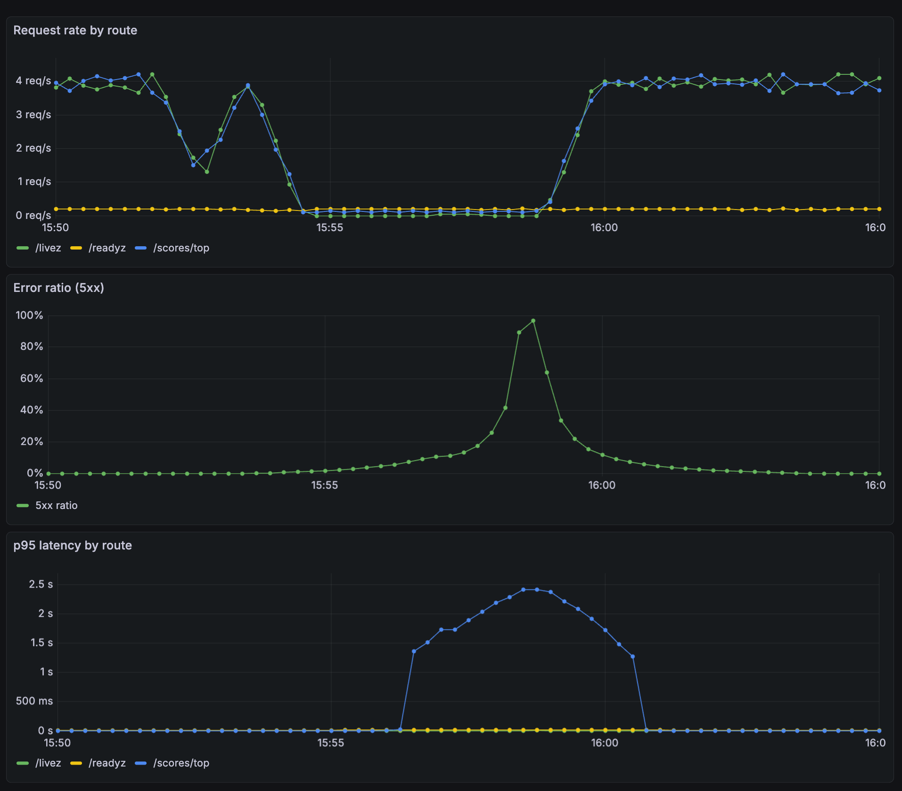

# scoreboard

[](https://github.com/ofelix60/scoreboard/actions/workflows/ci.yml)

A small FastAPI + Postgres service, deliberately deployed four different ways:
`docker run` → Compose → Kubernetes → AWS (EC2, ALB and RDS, with Terraform).

The service itself is intentionally boring. The point of this repo is **what changes and
what doesn't when the platform changes** — service discovery, health checking,
configuration, secrets, and persistence have to be solved on every platform, and each
one solves them differently.

## The thing I actually learned

Every platform has an answer to the same eight problems. Learning the fourth platform is
mostly learning new names for things you already understand:

| Problem | Docker / Compose | Kubernetes | AWS (EC2 + ALB + RDS) |
|---|---|---|---|
| health checking | `HEALTHCHECK`, Caddy `health_uri` | `livenessProbe` / `readinessProbe` | target group checks `/readyz`; ASG checks the VM |
| load balancing | Caddy `round_robin` over 2 replicas | Service + Deployment replicas | ALB → target group |
| removing sick instances | Caddy passive health | endpoint drops out of the EndpointSlice | target marked unhealthy, ALB stops routing to it |
| service discovery | bridge network, DNS by container name | cluster DNS + Service names | ALB and RDS DNS names, passed in by Terraform |
| configuration | `.env` + `--env-file` | ConfigMap | Terraform → user_data → `--env-file` |
| secrets | `.env`, gitignored | Secret | RDS-generated, in Secrets Manager, read at boot |
| persistence | named volume | PersistentVolumeClaim | RDS (encrypted gp3, daily backups) |
| resource limits | `--memory` | `resources.requests/limits` | the instance size (t4g.micro) |

Three findings worth more than the table:

**Kubernetes ignores `HEALTHCHECK` entirely.** A Dockerfile healthcheck is invisible to
the kubelet. The same logic has to be re-declared as probes.

**Liveness and readiness are not interchangeable, and conflating them causes outages.**
`/readyz` checks the database; `/livez` does not. Pointing a *liveness* probe at a
dependency check means a database blip restarts every replica simultaneously — turning
a degraded service into no service at all. I tested this on purpose and watched the
CrashLoopBackOff.

**"Deploy successful" can mean "serving errors".** On AWS, an instance refresh reported
`Successful` while the load balancer returned 106 502s: the new VM was running, so EC2
counted it healthy, but the app in it hadn't started. A platform's idea of healthy is
whatever it checks. Now a new instance can't take traffic until `/readyz` passes
(see [docs/aws.md](docs/aws.md)).

## Measured

| What | Result | Proof |
|---|---|---|
| Image size | 338MB → **66.6MB** | [design decisions](docs/design-decisions.md#the-image) |
| Empty kind cluster → serving | **2m05s** | [Run it](#run-it) |
| 502s during a deploy, before → after the readiness hook | **106 → 0**, on 3 deploys since | [AWS](docs/aws.md#a-deploy-waits-for-readyz-not-for-the-vm) |
| Database outage on AWS: detect / fix / total | **7m38s / 1m56s / 10m18s** | [postmortem](docs/postmortem-db-outage.md) |
| Database outage locally: until the Prometheus alert fires | **7m52s** | [runbook](docs/runbook.md) |
| AWS keys stored in CI | **0** (OIDC; another branch gets `AccessDenied`) | [AWS](docs/aws.md#ci-publishes-images-with-no-stored-aws-keys) |
| Database password in Terraform state or git | **never** | [AWS](docs/aws.md#the-database-password-has-never-been-in-terraform-or-in-git) |
| Inbound port 22 | **closed everywhere**; shell is SSM only | [AWS](docs/aws.md#no-port-22-anywhere) |
| Drift between Terraform and AWS | **none**, across 52 resources | [AWS](docs/aws.md) |
| AWS cost | **$1.12** for the stack's first day | [AWS](docs/aws.md#cost) |

## Architecture (Kubernetes)

```
Mac :80 ──► kind extraPortMappings ──► kind-control-plane
              └─► ingress-nginx (pinned to the control-plane node)
                    │  Host: scoreboard.127.0.0.1.nip.io
                    └─► Service scoreboard :80 → :8000
                          └─► Deployment scoreboard (2 replicas)
                              │   probes · resources · ConfigMap + Secret via envFrom
                              │   image pulled by digest from private GHCR
                              └─► StatefulSet sb-db-0 + headless Service + PVC
```

Under Compose the same service runs behind Caddy with health-gated `depends_on`. Both
stacks are in the repo and both work.

## Architecture (AWS)

```
client ──► ALB :80 (public subnets, 2 AZs)
             │  target group: GET /readyz every 10s
             └─► Auto Scaling group: 1 × t4g.micro, Amazon Linux 2023, arm64
                   │  user_data: pull the image from ECR, read the DB secret,
                   │  docker run with logs to CloudWatch
                   │  lifecycle hook: in service only once /readyz returns 200
                   ├─► RDS Postgres 16, db.t4g.micro (private subnets)
                   │     password generated by RDS, kept in Secrets Manager
                   └─► CloudWatch Logs /scoreboard-dev/app (7 days)

security groups   internet → alb :80 → app :8000 → db :5432
shell access      SSM Session Manager (no port 22, no key pair)
images            GitHub Actions ──OIDC──► ECR (build and push only)
```

One Terraform module (`terraform/modules/service`), called by one environment
(`terraform/envs/dev`). How each piece works and why: **[docs/aws.md](docs/aws.md)**.

## Run it

**Compose:**
```bash
cp .env.example .env     # DB_HOST, DB_PORT, DB_USER, DB_PASSWORD, DB_NAME
make up
curl -k https://localhost:8080/readyz
```

Then open:

- **Grafana** at http://localhost:3000. The `Scoreboard RED` dashboard is already there,
  with no login needed to view it.
- **Prometheus** at http://localhost:9090/targets. It should list **two** `scoreboard`
  targets, one per api replica.

**Tests** (no database or Docker needed):
```bash
uv run pytest -v
```

**Alert rule tests** (`promtool`, from the Prometheus image):
```bash
docker run --rm -v "$PWD/prometheus:/p" -w /p --entrypoint promtool \
  prom/prometheus:v3.7.3 test rules alerts_test.yml
```

**Kubernetes (kind):**
```bash
kind create cluster --config k8s/kind-cluster.yaml
kubectl apply -f k8s/ingress-nginx.yaml
kubectl wait -n ingress-nginx --for=condition=ready pod \
  --selector=app.kubernetes.io/component=controller --timeout=120s

# secrets are not in git — see Known gaps
kubectl apply -f k8s/secret.yaml
kubectl create secret docker-registry regcred \
  --docker-server=ghcr.io --docker-username=<user> --docker-password=<token>

kubectl apply -f k8s/configmap.yaml -f k8s/db-initdb-configmap.yaml \
  -f k8s/db-service.yaml -f k8s/db-statefulset.yaml \
  -f k8s/service.yaml -f k8s/deployment.yaml -f k8s/ingress.yaml

curl http://scoreboard.127.0.0.1.nip.io/scores/top
```

Measured: **2 minutes 5 seconds from an empty cluster to a serving stack**, using only
files in this repo plus the two secrets noted below.

**AWS (Terraform):**
```bash
cd terraform/envs/dev
terraform init            # state bucket: see backend.tf
terraform plan            # read it
terraform apply           # most of the time is RDS
curl "$(terraform output -raw url)/readyz"
```

Every push to `main` publishes the image to ECR, tagged with its short commit SHA. To
deploy one, set `image_tag` in `terraform/envs/dev/main.tf` and apply. An instance
refresh then replaces the instance, and the old one keeps serving until the new one
passes `/readyz`. A fresh database needs `schema.sql` applied once, by hand, over an
SSM session (see [known gaps](docs/known-gaps.md#aws)).

## API

| Endpoint | Returns | Notes |
|---|---|---|
| `GET /livez` | 200 while the process is alive | no dependencies — deliberately dumb |
| `GET /readyz` | 200 / 503 | opens its own connection, `connect_timeout=1` |
| `POST /scores` | 201 | `{"player": str, "score": int}` |
| `GET /scores/top` | 200 | `?limit=` validated `1..100` |
| `GET /metrics` | 200 | Prometheus text format; excluded from its own counters |

Every response carries an `X-Request-ID` header, 5xx included. Quote it to find the
matching log line.

Validation is declared, not hand-written: `pydantic.Field(min_length=1)` / `Field(ge=0)`
and `Query(10, ge=1, le=100)`. Invalid input returns a 422 naming the offending field,
with no `if` statements in the handler.

## Dashboard



Three panels, one for each RED question: **R**ate (requests per second by route),
**E**rrors (the share of responses that are 5xx), **D**uration (p95 latency by route).
The screenshot shows the database stopped for a few minutes under steady traffic.
The error ratio climbs, `/scores/top` p95 rises to the 2s pool timeout, and both
recover once the database is back. The earlier dip at about 15:52 is the api containers
restarting during a `make up`, not part of the outage (see [known gaps](docs/known-gaps.md#build-and-supply-chain)).

```promql
sum by (route) (rate(scoreboard_http_requests_total[1m]))

(sum(rate(scoreboard_http_requests_total{status=~"5.."}[5m])) or vector(0))
  / sum(rate(scoreboard_http_requests_total[5m]))

histogram_quantile(0.95,
  sum by (le, route) (rate(scoreboard_http_request_duration_seconds_bucket[5m])))
```

## More detail

| Document | What's in it |
|---|---|
| [Design decisions](docs/design-decisions.md) | 22 decisions about the app, the image, logging, metrics and alerting |
| [AWS deployment](docs/aws.md) | health checks, safe deploys, secrets, shell access, logs, CI, cost |
| [Postmortem](docs/postmortem-db-outage.md) | an induced RDS outage, timed from AWS's own records |
| [Runbook](docs/runbook.md) | what to do when the alert fires |
| [Known gaps](docs/known-gaps.md) | all 28, grouped, each with its fix |
| [Baseline stats](baseline-stats.md) | measured memory use, and why each limit is what it is |
| [Evidence](docs/evidence/) | captioned screenshots |

## Known gaps

Known, not hidden. All 28, grouped and each with a fix, are in
**[docs/known-gaps.md](docs/known-gaps.md)**. The five that matter most:

1. **The database password rotates every 7 days, but the app reads it once, at boot.**
   After a rotation, new connections fail until the instance is replaced.
2. **No TLS.** The load balancer serves HTTP only, and the database certificate isn't
   verified.
3. **Alerts notify nobody.** Neither the Prometheus alert nor the CloudWatch alarm is
   routed to a person.
4. **No migration tool.** The schema is seeded by `initdb` or applied by hand, on all
   three platforms.
5. **One of everything.** One instance and a single-AZ database. The outage drill lasted
   10 minutes.

## Layout

```
app.py                    FastAPI app, pool lifecycle, endpoints, middleware, metrics
logging_setup.py          structlog config: JSON on stdout, static context, redaction
logging.json              no-op uvicorn log config, so its records reach ours
build.py                  reads GIT_SHA / BUILD_TIME from the environment
sensitive_keys.py         key names the redact processor masks
schema.sql                table definition
tests/
  conftest.py             fake DB_* env set before app import; client + fake_db fixtures
  test_observability.py   request ID echo/replace, 503 body doesn't leak, metric labels
Dockerfile                multi-stage, digest-pinned, non-root
docker-compose.yaml       db + api + caddy + prometheus + grafana, health-gated depends_on
Caddyfile                 reverse proxy, dynamic upstream discovery
prometheus/
  prometheus.yml          5s scrape, DNS discovery of each api replica, loads alerts.yml
  alerts.yml              ScoreboardHighErrorRate: 5xx ratio > 5% for 5m, with a traffic guard
  alerts_test.yml         promtool unit tests: fires under failure, quiet on a low-traffic service
grafana/provisioning/
  datasources/prometheus.yml   Prometheus datasource, fixed uid
  dashboards/dashboards.yml    loads every .json in this folder
  dashboards/scoreboard.json   the RED dashboard, exported from the UI
docs/
  design-decisions.md          why the code and config are the way they are
  aws.md                       the AWS deployment, piece by piece
  known-gaps.md                every known gap, grouped, with its fix
  postmortem-db-outage.md      the induced RDS outage: timeline, MTTD, what to change
  runbook.md                   what to do when each alert fires
  grafana-red-db-outage.png    the dashboard during a database outage
  evidence/                    captioned screenshots of the running systems
Makefile                  up / down / destroy / fmt / lint
bench.sh                  build time + image size, appended to benchmarks.md
baseline-stats.md         measured usage, and why each mem_limit is what it is
.env.example              the five variables Compose needs
.github/workflows/
  ci.yml                  lint, typecheck, test, promtool, image build on every PR and on main
  publish.yml             on push to main: build the arm64 image, push to ECR via OIDC
.dockerignore             keeps .env, k8s/ (incl. the real Secret), terraform/, monitoring config and caches out of the image
terraform/
  envs/dev/
    backend.tf            S3 remote state, native lockfile, default_tags
    main.tf               calls the service module; image_tag picks what's deployed
    github.tf             GitHub OIDC provider and the publish role CI assumes
  modules/service/
    main.tf               VPC, subnets, routes, security groups, ECR repository
    alb.tf                load balancer, target group (/readyz), listener
    asg.tf                launch template, ASG, instance refresh, lifecycle hook, alarm
    user_data.sh.tftpl    boot: pull image, read DB secret, run container, report ready
    rds.tf                Postgres 16 with an RDS-managed password
    iam.tf                instance role: SSM, ECR pull, one secret, one log group
    logs.tf               log group with 7-day retention
k8s/
  kind-cluster.yaml       3-node cluster, extraPortMappings, ingress-ready label
  ingress-nginx.yaml      vendored controller-v1.15.1, nodeSelector patched
  deployment.yaml         2 replicas, probes, resources, envFrom, imagePullSecrets
  service.yaml            ClusterIP :80 → :8000
  ingress.yaml            host-based routing
  configmap.yaml          non-secret config
  secret.example.yaml     shape of the Secret; the real one is gitignored
  serviceaccount.yaml     zero-permission SA, token mount disabled
  teammate-role.yaml      least-privilege Role + RoleBinding (pods/logs, no secrets)
  db-statefulset.yaml     Postgres + volumeClaimTemplates
  db-service.yaml         headless
  db-initdb-configmap.yaml
```
