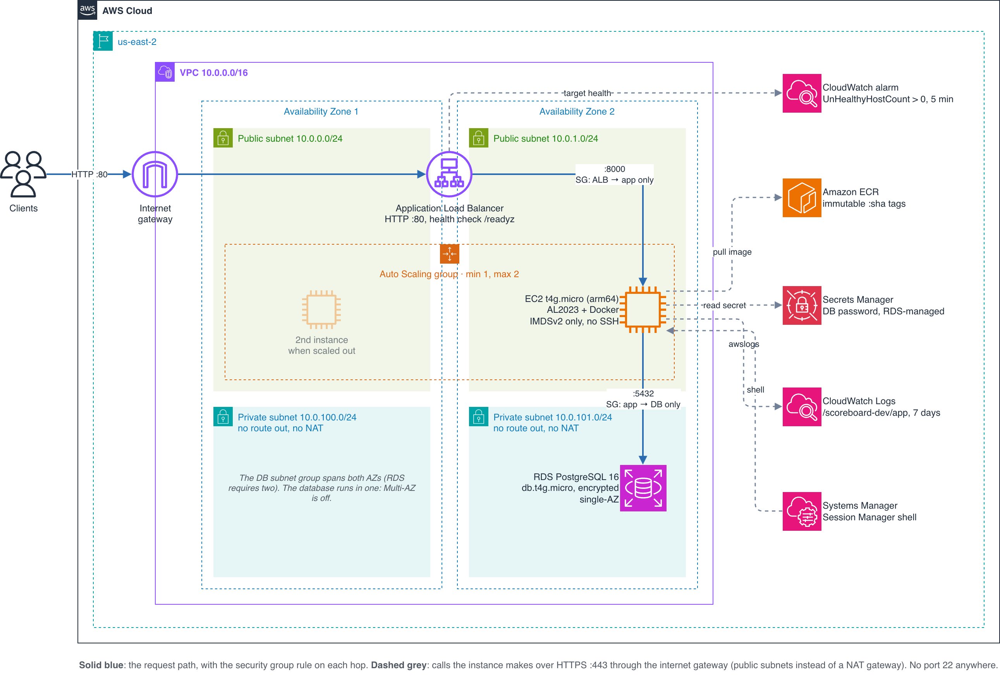

# AWS deployment



The same in text, with what each instance does at boot:

```
client ──► ALB :80 (public subnets, 2 AZs)
             │  target group: GET /readyz every 10s
             └─► Auto Scaling group: 1 × t4g.micro, Amazon Linux 2023, arm64
                   │  user_data: pull the image from ECR, read the DB secret,
                   │  docker run with logs to CloudWatch
                   │  lifecycle hook: in service only once /readyz returns 200
                   ├─► RDS Postgres 16, db.t4g.micro (private subnets)
                   │     password generated by RDS, kept in Secrets Manager
                   └─► CloudWatch Logs /scoreboard-dev/app (7 days)

security groups   internet → alb :80 → app :8000 → db :5432
shell access      SSM Session Manager (no port 22, no key pair)
images            GitHub Actions ──OIDC──► ECR (build and push only)
```

`terraform/modules/service` holds all of it, and `terraform/envs/dev` calls it with
values for dev. State lives in S3 with native locking. That's 52 resources, and
`terraform plan -detailed-exitcode` returns 0 against the running stack.

The diagrams are drawn in [draw.io](https://app.diagrams.net). The source is
[diagrams/aws.drawio](diagrams/aws.drawio), and each exported PNG also embeds it, so
either one opens for editing in draw.io.

Every claim here has a measurement or a record behind it. The screenshots are in
[evidence/](evidence/), and the outage is written up in
[postmortem-db-outage.md](postmortem-db-outage.md). What's still missing is in
[known-gaps.md](known-gaps.md#aws).

### Health checks are split between the load balancer and the Auto Scaling group, on purpose

The target group checks `/readyz` every 10s, so an instance that can't reach the
database stops getting traffic within about 30s. The ASG uses EC2 status checks, not the
load balancer's, so it only replaces an instance whose VM has failed. This was tested by
stopping RDS for ten minutes under steady traffic. The target went unhealthy, the ASG
recorded no activity, and the instance was still serving 200s two seconds after the
database came back. With load-balancer health checks, the ASG would have replaced a
working instance with one that also failed `/readyz`. The case this leaves uncovered is
a VM that runs fine while its app is stuck. An alarm on `UnHealthyHostCount` is how
someone finds out.

### A deploy waits for `/readyz`, not for the VM

The first measured deploy, with a request every second, got 106 502s out of 268
requests. The load balancer had moved to the new instance before the container in it was
ready. Now a launch lifecycle hook holds each new instance in `Pending:Wait` until its
boot script sees `/readyz` return 200, and the old instance isn't terminated until then.
Three deploys through the hook since, with zero load-balancer 5xx. One of them had a
broken boot script. The new instance never reported ready, the old one kept serving (442
of 442 requests returned 200), and I cancelled the refresh.

### The database password has never been in Terraform or in git

With `manage_master_user_password`, RDS generates the password and keeps it in Secrets
Manager. Terraform state stores only the secret's ARN (`password` is `null`). The
instance role can read that one secret. The boot script fetches it and writes it to a
root-only env file, which is deleted once the container exists. That keeps the password
off any command line, where `ps` and cloud-init's log would show it.

### No port 22, anywhere

No security group allows it, the instances have no key pair, and the boot script
disables sshd. Shell access is through SSM Session Manager. The agent on the instance
connects out to AWS, so the instance doesn't need to accept any inbound connection for
it. Every session is a CloudTrail `StartSession` event recording who, when, and which
instance.

### Logs reach CloudWatch without slowing requests down

Docker's `awslogs` driver runs in non-blocking mode with a 4 MB buffer, so if CloudWatch
is slow, log lines are dropped instead of requests waiting. Each instance writes its own
stream, named by instance ID. Retention is 7 days, set in Terraform; CloudWatch's
default is to keep logs forever. A Logs Insights query on `request_id` finds every line
for one request, using the same ID the client received in `X-Request-ID`.

### CI publishes images with no stored AWS keys

On every push to `main`, GitHub Actions builds the image on an arm64 runner and pushes
it to ECR. It authenticates with OIDC, which gives a role session lasting at most an
hour, and only to tokens for this repository's `main` branch. The repo uses GitHub's
immutable subject format, which identifies the owner and the repository by numeric ID,
not by name. A repository recreated under the same name gets a new ID, so it can't
assume the role. CloudTrail shows it working in both directions: `main` gets
credentials, and another branch of the same repo gets `AccessDenied`. `terraform apply`
still runs by hand. CI can publish an image but can't change infrastructure.


Steps ① and ② are CI publishing an image. Steps ③ to ⑥ are a person deploying it, and
⑤ to ⑥ are the wait for `/readyz` described [above](#a-deploy-waits-for-readyz-not-for-the-vm).

### What an outage looks like, measured

With RDS stopped under traffic, the alarm fired after 7m38s and service was back 1m56s
after the database was started. The ALB failed open: with its only target unhealthy, it
kept routing to it. So clients got the app's fast 503 (182 counted as `Target_5XX`)
rather than a load-balancer 502 (0 `ELB_5XX`). RDS's own status lagged reality both
ways. It said "stopped" 6 minutes after the app started failing, and "available" 1.5
minutes after traffic had recovered.

### Cost

$1.12 billed through November 22, the stack's first day, paid from free-plan credits
(billing lags about a day). The load balancer was the biggest line at $0.41, then RDS
at $0.28 and the public IPv4 addresses at $0.26. The EC2 instance itself was $0.14,
less than the IP addresses it and the load balancer use. There's no NAT gateway: at
about $33 a month before data charges, it would be the most expensive single thing in
the stack.
